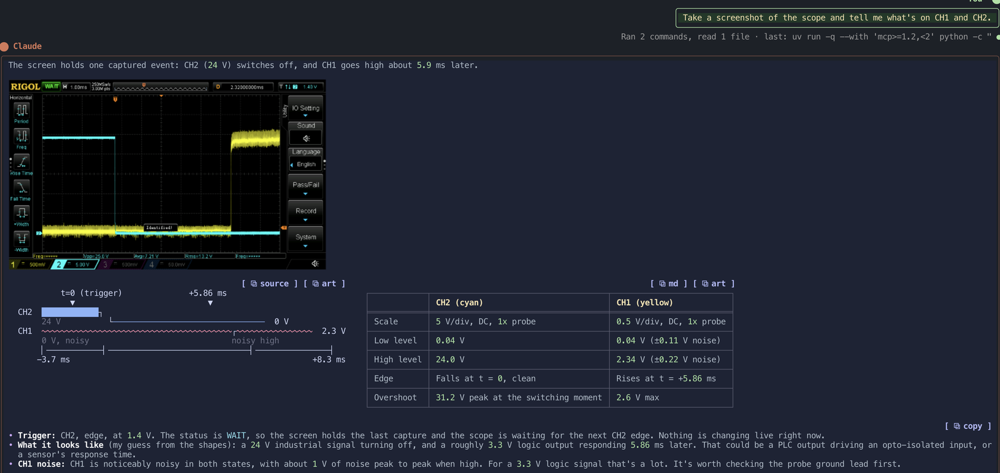

# rigol-mcp

An [MCP](https://modelcontextprotocol.io) server that lets AI agents (Claude Code, Claude Desktop,
Cursor, and other MCP clients) read and control a **Rigol DS1000Z** oscilloscope over the network.

Ask your agent things like *"take a screenshot of the scope and tell me what's on CH1"* or
*"what's the ripple on CH2?"*. It reads measurements, downloads waveforms, captures the screen,
and changes settings when you ask.

- **No drivers.** Talks SCPI over the scope's raw TCP socket (port 5555). No VISA, no NI software.
- **Two ways to run.** Locally over stdio for one agent, or in Docker over HTTP as a shared
  bridge for several agents and machines.
- **Screenshot history.** Every screenshot and waveform is saved with a UTC timestamp. The last
  N are kept, and a web gallery shows them.
- **Careful by default.** Settings change only through one explicit tool. Reset is blocked, and
  a read-only mode is available.



*Claude Code asked to "take a screenshot of the scope and tell me what's on CH1 and CH2". It reads
the screen and the measurements, then explains the event: a 24 V signal switching off, and a
logic signal responding 5.86 ms later.*

### Things to ask

- "Take a screenshot of the scope and tell me what's on each channel."
- "What's the frequency and duty cycle on CH1?"
- "Measure the delay between the CH2 falling edge and the CH1 rising edge."
- "Download CH1 and check how much noise is on the high level."
- "Show me the screenshot from 10 minutes ago and compare it with the scope now."
- "Set CH1 to 1 V/div and arm a single trigger on CH2's rising edge." *(changes settings)*

Tested on a DS1104Z (firmware 00.04.04.SP3). Other DS1000Z and MSO1000Z models (DS1054Z,
DS1074Z, DS1102Z-E, MSO1104Z and so on) use the same command set and should work. Reports welcome.

## Contents

- [Tools](#tools)
- [Before you start](#before-you-start)
- [Option 1: Local (stdio)](#option-1-local-stdio)
- [Option 2: Docker (HTTP bridge)](#option-2-docker-http-bridge)
- [Option 3: HTTP without Docker](#option-3-http-without-docker)
- [Screenshot history and gallery](#screenshot-history-and-gallery)
- [Configuration](#configuration)
- [Security](#security)
- [Troubleshooting](#troubleshooting)
- [Development](#development)

## Tools

| Tool | What it does | Touches the scope |
|---|---|---|
| `scope_status` | Model, trigger, timebase, and per channel: V/div, offset, coupling, Vpp, Vavg, Vrms, frequency | reads |
| `scope_measure` | Any of the 20 built-in measurements on one channel (rise time, duty cycle, ...) | reads |
| `scope_waveform` | The 1200 on-screen samples: stats, clipping warning, optional full CSV | reads |
| `scope_screenshot` | Captures the display as a PNG (the agent sees the image) and saves it | reads |
| `scope_screenshot_history` | Lists saved screenshots, newest first | no |
| `scope_screenshot_get` | Returns a saved screenshot (`latest` or by id) | no |
| `scope_waveform_history` | Lists saved waveform CSVs | no |
| `scope_query` | Any read-only SCPI query (must end in `?`) | reads |
| `scope_write` | Changes a setting (V/div, timebase, trigger, run/stop, ...) | **writes** |

Invalid measurements (the scope's `9.9E37` or `measure error!`, e.g. the frequency of a DC
signal) come back as `null` instead of a misleading number.

## Before you start

1. Connect the scope to your network and note its IP address: **Utility > IO Setting > LAN Conf**.
2. Check that your machine can reach it:

   ```bash
   echo '*IDN?' | nc -w 3 192.168.1.50 5555
   ```

   You should see something like `RIGOL TECHNOLOGIES,DS1104Z,DS1ZA...,00.04.04.SP3`.

3. Install [uv](https://docs.astral.sh/uv/getting-started/installation/) for the local option,
   or Docker for the bridge.

Replace `192.168.1.50` with your scope's address everywhere below.

## Option 1: Local (stdio)

Best for one person and one agent on a machine that can reach the scope. Your MCP client starts
the server as a subprocess, so nothing listens on the network.

**Claude Code**

```bash
claude mcp add --scope user rigol -e RIGOL_HOST=192.168.1.50 -- \
  uvx --from git+https://github.com/lfhohmann/rigol-mcp rigol-mcp
```

**Claude Desktop, Cursor, and other clients**: add this to the client's MCP config
(for Claude Desktop, `claude_desktop_config.json`):

```json
{
  "mcpServers": {
    "rigol": {
      "command": "uvx",
      "args": ["--from", "git+https://github.com/lfhohmann/rigol-mcp", "rigol-mcp"],
      "env": { "RIGOL_HOST": "192.168.1.50" }
    }
  }
}
```

Screenshots and waveforms are saved in `~/.local/share/rigol-mcp/` (set `RIGOL_DATA_DIR` to
change it). There is no gallery page in this mode, but the files are there to browse.

> The scope handles only one network client well. Every agent session in stdio mode starts its
> own server process, so with several agents at once, use the Docker bridge instead.

## Option 2: Docker (HTTP bridge)

Best when several agents or machines share one scope. The container is the scope's only client
and takes turns for everyone. It serves MCP over HTTP with a token and hosts the screenshot gallery.

```text
 Claude Code (laptop) ─┐
 Claude Code (server) ─┼─ HTTP + token ──► rigol-mcp container ── SCPI :5555 ──► scope
 other MCP clients ────┘     :8790/mcp       (gallery, history)
```

The prebuilt image `ghcr.io/lfhohmann/rigol-mcp` runs on amd64 and arm64 (including the
Raspberry Pi 4 and 5). You don't need to clone the repo.

1. Make a folder with the compose file and the settings template:

   ```bash
   mkdir rigol-mcp && cd rigol-mcp
   curl -fsSLO https://raw.githubusercontent.com/lfhohmann/rigol-mcp/main/compose.yaml
   curl -fsSL https://raw.githubusercontent.com/lfhohmann/rigol-mcp/main/.env.example -o .env
   ```

2. Edit `.env`: set `RIGOL_HOST`, a token (`openssl rand -hex 24`), and `RIGOL_PUBLIC_URL`
   (how clients reach this machine, e.g. `http://192.168.1.10:8790`). Set `UID` and `GID` to
   the output of `id -u` and `id -g` so the saved files belong to you.

3. Create the data folder and start the container:

   ```bash
   mkdir -p data
   docker compose up -d
   ```

   To update later, run `docker compose pull && docker compose up -d`. To build from source
   instead, clone the repo and run
   `docker compose -f compose.yaml -f compose.build.yaml up -d --build`.

4. Check that it's up (no token needed):

   ```bash
   curl http://localhost:8790/health
   ```

5. Connect each client. For Claude Code:

   ```bash
   claude mcp add --scope user --transport http rigol http://192.168.1.10:8790/mcp \
     --header "Authorization: Bearer <your-token>"
   ```

   Other clients that support streamable HTTP use the same URL and header.

Screenshots and waveforms are written to `./data/screenshots` and `./data/waveforms` on the host.
The container restarts automatically (`restart: unless-stopped`).

## Option 3: HTTP without Docker

Same as the bridge, but run directly with uv:

```bash
RIGOL_HOST=192.168.1.50 RIGOL_MCP_TOKEN=<your-token> RIGOL_PUBLIC_URL=http://192.168.1.10:8790 \
  uvx --from git+https://github.com/lfhohmann/rigol-mcp rigol-mcp --http --port 8790
```

## Screenshot history and gallery

- Every `scope_screenshot` call saves a PNG named with its UTC time, e.g.
  `screenshot_20261124T173058.934Z.png`. The last `RIGOL_KEEP_SCREENSHOTS` (default 100) are
  kept and older ones are deleted. Waveforms work the same way (`RIGOL_KEEP_WAVEFORMS`).
- Agents can look back without touching the scope: `scope_screenshot_history` lists them and
  `scope_screenshot_get` returns one (`latest` by default).
- In HTTP mode, open the gallery in a browser:

  ```text
  http://192.168.1.10:8790/screenshots?token=<your-token>
  ```

  

  The token in the URL is stored as a cookie, so later visits to `/screenshots` work without it.
  Single files are at `/screenshots/<file name>` and `/waveforms/<file name>`, and
  `/screenshots/latest` always gives the newest screenshot.

## Configuration

All settings are environment variables. In Docker they go in `.env`.

| Variable | Default | Meaning |
|---|---|---|
| `RIGOL_HOST` | (required) | Scope IP address or host name (or pass `--scope`) |
| `RIGOL_PORT` | `5555` | Scope SCPI port |
| `RIGOL_TIMEOUT` | `10` | Seconds to wait for the scope |
| `RIGOL_DATA_DIR` | `~/.local/share/rigol-mcp` (`/data` in Docker) | Where captures are saved |
| `RIGOL_KEEP_SCREENSHOTS` | `100` | Screenshots to keep; `0` keeps all |
| `RIGOL_KEEP_WAVEFORMS` | `100` | Waveform CSVs to keep; `0` keeps all |
| `RIGOL_READ_ONLY` | off | `1` blocks `scope_write` |
| `RIGOL_TRANSPORT` | `stdio` | `http` is the same as `--http` |
| `RIGOL_HTTP_HOST` | `0.0.0.0` | HTTP bind address (or `--bind`) |
| `RIGOL_HTTP_PORT` | `8790` | HTTP port (or `--port`) |
| `RIGOL_MCP_TOKEN` | (required for HTTP) | Token clients must send |
| `RIGOL_ALLOW_NO_AUTH` | off | `1` allows HTTP without a token (trusted networks only) |
| `RIGOL_PUBLIC_URL` | none | Base URL used in links to screenshots and the gallery |
| `RIGOL_HOST_PORT` | `8790` | Docker only: port published on the host |

## Security

- **Writes are explicit.** Only `scope_write` changes settings, and its description tells agents
  to use it only when you ask. `*RST` is blocked. `RIGOL_READ_ONLY=1` turns writes off completely.
  Real circuits may be connected to the probes, so keep it that way.
- **HTTP mode needs a token.** It's checked in constant time on every request except `/health`.
- **The traffic is plain HTTP.** On an untrusted network, put the server behind a VPN
  (WireGuard, NetBird, Tailscale) or an HTTPS reverse proxy such as Caddy or Traefik.
- **The scope itself has no authentication.** Anyone who can reach port 5555 can control it.
  Keep it on a network you trust.

## Troubleshooting

| Symptom | Cause and fix |
|---|---|
| `cannot connect to scope` | Wrong IP, or the scope's LAN is off. Check **Utility > IO Setting**, then run the `nc` test above. |
| Works, then hangs or times out | Another program (the scope's web page, UltraScope, a second server) is connected. Use one client at a time. |
| A measurement is `null` | The scope can't measure it: no edges, or the signal is off screen. Look at the screenshot. |
| `clipped_samples > 0` | The trace goes off screen, so min, max and Vpp are wrong. Change V/div or offset. |
| HTTP clients get 401 | Missing or wrong `Authorization: Bearer <token>` header. |
| Files in `./data` owned by root, or permission errors | Create `data/` before the first start and set `UID`/`GID` in `.env`. |

Need a command the tools don't cover? `scope_query` and `scope_write` accept any SCPI command
from Rigol's *MSO1000Z/DS1000Z Programming Guide* (on Rigol's website).
[docs/direct-scpi.md](docs/direct-scpi.md) shows how to talk to the scope without this server.

## Development

```bash
git clone https://github.com/lfhohmann/rigol-mcp.git
cd rigol-mcp
uv sync
uv run pytest
```

The tests use a fake scope (`tests/fake_scope.py`), so no hardware is needed. To try your changes
against a real scope:

```bash
RIGOL_HOST=192.168.1.50 uv run rigol-mcp            # stdio
RIGOL_HOST=192.168.1.50 RIGOL_MCP_TOKEN=dev uv run rigol-mcp --http
```

## License

[MIT](LICENSE)
